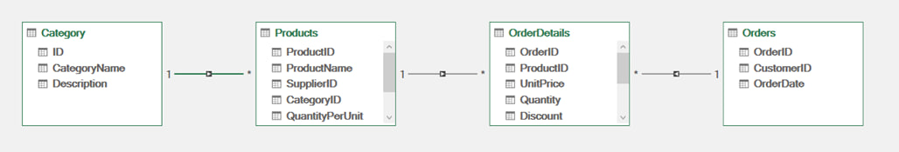
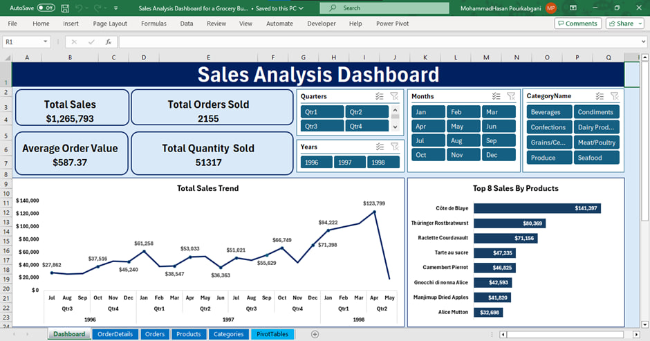
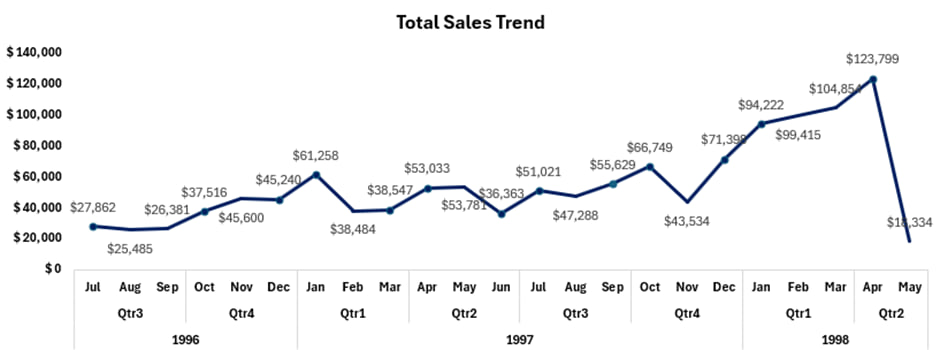
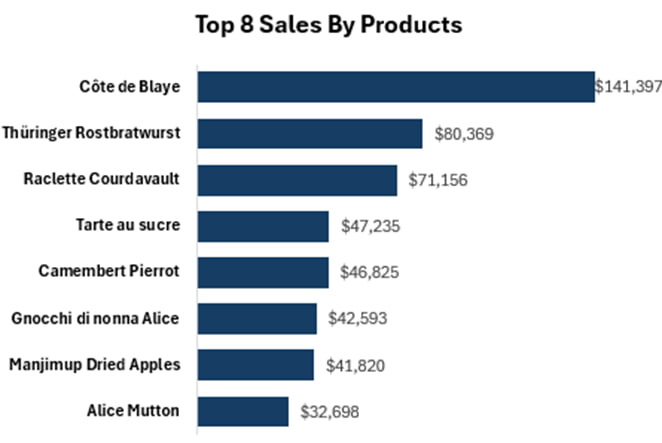
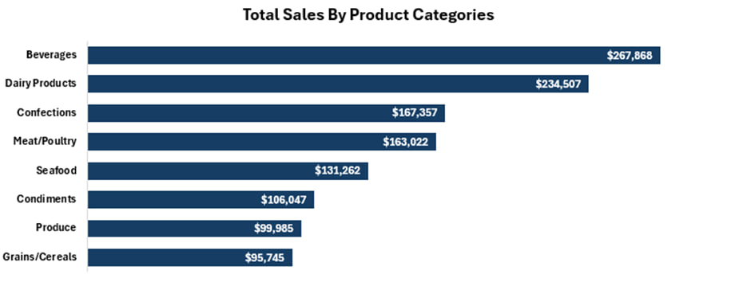
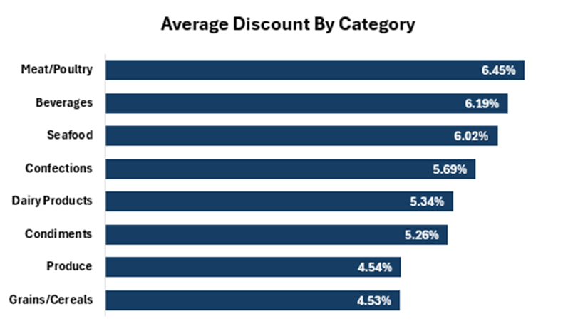

# Sales-Analysis-Dashboard-Northwind-Dataset-Excel-
Interactive Excel dashboard analyzing grocery sales (Northwind dataset) — built end-to-end with Power Query (ETL, Merge), Pivot Tables/Charts &amp; Slicers. From raw data to real business insights: sales trends, top products, categories &amp; discount analysis.

---
Welcome to one of my favorite portfolio projects!
It all started with a simple question:

> *"If I were the manager of a grocery business, how would I actually know how my business is doing?"*

The answer isn't hiding in a pile of spreadsheets — the data was scattered across **5 separate tables**, and until someone cleans them up and connects them, they're just thousands of raw rows. So I decided to do the whole thing myself, from zero to dashboard: take raw data, clean it, model it, build the missing metrics, and deliver an interactive dashboard that answers real business questions with a single click. 

---

##  Business Questions This Dashboard Answers

- What does the sales trend look like? (yearly, quarterly, monthly)
- Which products sell the most?
- Which product categories drive the most revenue?
- What is the average discount per category — and is it actually working?
- What is the total revenue?
- How many order lines were sold?
- What is the average order value?
- How many units were sold in total?

---

##  The Dataset

**Northwind** — transactional data of a food distribution business (Jul 1996 – May 1998):

| Table | What's Inside | Size |
|-------|---------------|------|
| Orders | Order date, customer ID | 830 orders |
| Order Details | Line items: UnitPrice, Quantity, Discount | 2,155 rows |
| Products | Product name, unit price, category | 77 products |
| Categories | 8 product categories | — |
| Customers | Customer IDs | — |

> **Fun fact:** there was no "Sales" column in the raw data. I had to build it myself (see Feature Engineering below 👇).

---

##  How I Built It (Step by Step)

### 1️⃣ ETL with Power Query

Loaded all source tables into Power Query so every transformation is logged, repeatable, and refreshable — zero manual edits on the raw data. If new data shows up tomorrow, one click on **Refresh** reruns the entire pipeline.

### 2️⃣ Data Cleaning

- Fixed data types (e.g., converted `OrderDate` from text to a proper Date type)
- Handled missing values
- Removed duplicates
- Standardized column names

### 3️⃣ Data Modeling

Instead of fragile nested VLOOKUPs, I merged the tables in Power Query on their business keys (`OrderID`, `ProductID`, `CategoryID`) to build one clean, analysis-ready dataset.



### 4️⃣ Feature Engineering

This was the fun part. Revenue didn't exist in the raw data, so I created it — with the discount factored in, because a 20%-off sale is not the same as a full-price sale:

`Sales = Quantity × UnitPrice × (1 − Discount)`

I also extracted **Year / Quarter / Month** from the order date to enable time-based analysis.

### 5️⃣ Visualization & Interactivity

- **Line Chart** ← for time trends
- **Sorted Bar Charts** with a Top N filter ← for product & category rankings
- **KPI Cards** ← for the headline numbers
- **Slicers** (Year, Quarter, Month, Category) ← connected to everything, so one click filters the entire dashboard



---

##  KPIs at a Glance

| KPI | Value |
|-----|-------|
|  Total Sales | $1,265,793 |
|  Total Order Lines | 2,155 |
|  Average Order Value | $587.37 |
|  Total Quantity Sold | 51,317 |

##  Key Insights

### Sales Trend: A Real Growth Story

- Started around **$28K/month** in H2 1996 ← peaked at **$123,799** in April 1998
- 1996 (6 months): **$208K** ← 1997 (full year): **$617K** ← 1998 (just 5 months!): **$440K**
- That last one is wild: in only 5 months, 1998 delivered ~**71%** of ALL of 1997. The business didn't just grow — it accelerated.
- Clear seasonal peaks: **Q4 1997** ($181K) and **Q1 1998** ($298K)



###  Top Products: 8 Giants Among 77

The Top 8 products generated ~**$504K** ≈ **40%** of total revenue:

| # | Product | Sales |
|---|---------|-------|
| 1 | Côte de Blaye | $141,397 |
| 2 | Thüringer Rostbratwurst | $80,369 |
| 3 | Raclette Courdavault | $71,156 |
| 4 | Tarte au sucre | $47,235 |
| 5 | Camembert Pierrot | $46,825 |
| 6 | Gnocchi di nonna Alice | $42,593 |
| 7 | Manjimup Dried Apples | $41,820 |
| 8 | Alice Mutton | $32,698 |

**Côte de Blaye** alone accounts for ~**11%** of all revenue. A star product… but also a **concentration risk**: if its supply ever breaks, there's a big hole in revenue.



###  Category Performance

- **Beverages** ($267,868) and **Dairy Products** ($234,507) are the revenue engines — together roughly **40%** of total sales
- At the bottom: **Grains/Cereals** ($95,745) and **Produce** ($99,985) — either they need a boost, or we need to find out why they're lagging.



###  Discount Analysis (My Favorite Finding)

Overall average discount: **5.62%**. But here's the twist:

- **Meat/Poultry** has the highest average discount (**6.45%**)… but ranks only **4th** in revenue. We're paying for discounts without getting proportional returns. 
- **Beverages** holds both the top revenue spot AND a high discount (**6.19%**) ← this category likely depends on discounts, so its profit margin needs close monitoring
- **Grains/Cereals** (4.53%) & **Produce** (4.54%) get the least discount and sell the least — prime candidates for a test promotion

This is exactly the kind of question a good dashboard helps you ask — a question you'd easily miss staring at static reports.



---

##  Business Recommendations

1. **Manage concentration risk** — ~40% of revenue depends on just 8 products; expand the mid-tier product portfolio
2. **Rethink the discount strategy** — high discounts on Meat/Poultry aren't paying off; make discounts targeted, not blanket
3. **Build a seasonal calendar** — align inventory & campaigns with the Q4/Q1 sales peaks
4. **Give low performers a chance** — test promotions on Grains/Cereals & Produce
5. **Next phase** — add customer analysis (RFM) and gross profit tracking

---

##  Skills Demonstrated

| Area | What I Actually Did |
|------|---------------------|
| Power Query (ETL) | Loaded, cleaned & merged 5 tables into a repeatable pipeline |
| Data Cleaning | Fixed data types, handled missing values, removed duplicates |
| Data Modeling | Merged tables on business keys (star-schema mindset) |
| Feature Engineering | Built the discount-aware Sales metric + time dimensions |
| Pivot Tables & Charts | Built all visuals on a pivot architecture |
| Dashboard Design | KPI cards, Top N filtering, Slicer interactivity, clean layout |
| Data Storytelling | Turned numbers into business insights & recommendations |

---

##  What I Learned

The hardest part wasn't any single feature — it was deciding **where and how to define the metrics**. Along the way, I got comfortable with Power Query (ETL & Merge), data modeling, feature engineering, and interactive dashboard design.

But the real mindset shift? I used to see a chart as an output. Now I see it as an **answer to a question** — and if you don't ask the right question, even the prettiest dashboard in the world is useless.

---

## 🗂️ Repository Structure
```
 ┣ Dataset/
 ┃ ┣ Northwind-Dataset.xlsx                    
 ┣ assets/                           # screenshots used in this README
 ┃ ┣ Dashboard-preview.jpg
 ┃ ┣ Total-Sales-Trend.jpg
 ┃ ┣ Relation-between-tables.jpg
 ┃ ┣ Top-8-Sales-By-Product.jpg
 ┃ ┣ Top-Sales-By-Product-Categories.jpg
 ┃ ┗ Average-Discount-By-Category.jpg
 ┣ dashboard/
 ┃ ┗ Sales Analysis Dashboard for a Grocery Business.xlsx
 ┣ report/
 ┃ ┗ Sales Analysis Dashboard for a Grocery Business.pdf
 ┗ README.md
```

---

## 🚀 How to Use

1. Download `Sales Analysis Dashboard for a Grocery Business.xlsx` from the `dashboard/` folder
2. Open it in **Excel 2016+** or **Microsoft 365** (required for Power Query)
3. Click **Enable Editing** if prompted
4. Play with the **Slicers** (Year / Quarter / Month / Category) and watch the whole dashboard respond ✨

---

## 📬 How to  Contact!

-  **LinkedIn** — [MohammadHasan Pourkabgani](https://www.linkedin.com/in/mohammadhasan-pourkabgani/)
-  **GitHub** — [Hasanprk](https://github.com/Hasanprk)
-  **Email** — mh.pourkabgani91@gmail.com

If you found this project useful or have any feedback, I'd genuinely love to hear it! 
